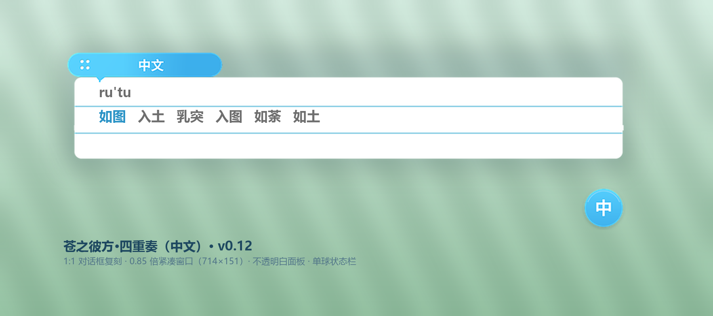
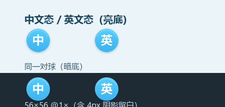

# Aokana × Sogou Input Skin（苍之彼方·四重奏 搜狗输入法皮肤）

以《苍之彼方的四重奏》（*Aokana: Four Rhythms Across the Blue*）游戏内对话框的视觉语言——**天蓝渐变胶囊名牌、小尾巴、2×2 圆点、纯白面板与青色细线**——1:1 复刻而成的 Windows 搜狗输入法皮肤。



---

## ✨ 视觉与特性（v0.12）

- **1:1 对话框结构映射**：
  - **蓝色胶囊名牌**：独立全圆角胶囊 + 下方小尾巴 + 左侧 2×2 白点，作为输入模式铭牌（提供 **中文 / 英文 / 双拼** 三套底图）。
  - **第一行台词 → 拼音串**：采用 `#6E6E6E` 正文灰，像台词一样清晰呈现。
  - **第二行台词 → 候选词**：落在两条 `#8FD0E6` 青色分隔线之间；首选词采用 `#2A93C6` 深天蓝高亮，其余候选保持 `#6E6E6E` 正文灰。
- **0.85 倍黄金尺寸**：横排候选窗尺寸 `714×151`（1×），搭配 `17px` **微软雅黑 Bold** 粗体（零额外字体安装成本，开箱即用）。
- **100% 不透明白面板**：保证在深色、浅色及复杂桌面壁纸下都有出色的文字对比度（≥ 4.5:1）。
- **单球状态栏**：精简为 `56×56` 天蓝渐变圆球（支持中/英点击切换与常态/悬停/按下三态反馈）。

### 名牌三态变体


### 单球状态栏



---

## 📦 下载与安装

打包好的皮肤文件位于 [`dist/`](dist/)（及 [`dist/v0.12/`](dist/v0.12/)）目录下：

| 文件 | 皮肤名称 | 名牌标签 | 大小 |
| :--- | :--- | :--- | :--- |
| [`dist/aokana-zh.ssf`](dist/aokana-zh.ssf) | 苍之彼方·四重奏（中文） | **中文** | 57.0 KB |
| [`dist/aokana-en.ssf`](dist/aokana-en.ssf) | 苍之彼方·四重奏（英文） | **英文** | 57.4 KB |
| [`dist/aokana-sp.ssf`](dist/aokana-sp.ssf) | 苍之彼方·四重奏（双拼） | **双拼** | 57.4 KB |

### 安装步骤
1. 下载上述任一（或全部）`.ssf` 皮肤文件。
2. **双击 `.ssf` 文件**，在搜狗输入法弹出的「安装皮肤」对话框中点击**确定**即可自动切换生效。
3. 建议在搜狗输入法「属性设置 → 外观」中使用**横排**候选展示以获得最佳视觉还原效果。

详细说明可参考 [docs/安装说明.md](docs/安装说明.md)。

---

## 🛠️ 从源码构建

本项目使用开源的 [`dsh-sogou-skin`](tools/dsh-sogou-skin/)（MIT）工具链进行工程化装配、九宫格校验、引擎模型预览与打包。

```powershell
# 1. 装配工程（生成 Skin.ini 与规范化槽位文件）
node tools/dsh-sogou-skin/src/cli.js assemble build/aokana-zh
node tools/dsh-sogou-skin/src/cli.js assemble build/aokana-en
node tools/dsh-sogou-skin/src/cli.js assemble build/aokana-sp

# 2. 校验皮肤包（0 Error / 0 Warning）
node tools/dsh-sogou-skin/src/cli.js validate dist/aokana-zh.ssf

# 3. 打包生成 .ssf
node tools/dsh-sogou-skin/src/cli.js pack build/aokana-zh --format zip --out dist/aokana-zh.ssf

# 4. 调用本机搜狗 SGTool.exe 安装并实时切换
node tools/dsh-sogou-skin/src/cli.js install dist/aokana-zh.ssf
```

---

## 📁 目录结构

```text
aokana-skin/
├─ dist/                        # 打包完成的 .ssf 皮肤文件（中文 / 英文 / 双拼）
├─ build/                       # 三套皮肤装配工程（skin.project.json 与构建产物）
├─ assets/                      # 皮肤 PNG 素材与生成脚本（assets/_gen/make_assets.py）
├─ docs/                        # 安装说明与预览图
├─ tools/
│  ├─ dsh-sogou-skin/           # 搜狗皮肤工程化 CLI 工具链（MIT）
│  └─ *.py                      # 面板重绘、锐化下采样与预览图渲染脚本
├─ LICENSE                      # MIT 许可证与非官方同人声明
└─ README.md
```

---

## ⚠️ 免责声明与许可

- **非官方同人作品**：本项目是以《苍之彼方的四重奏》（*Aokana: Four Rhythms Across the Blue*）UI 视觉风格为灵感制作的非官方同人皮肤，**仅供学习交流与个人非商业使用**，与 sprite、NekoNyan 及搜狗输入法官方无关。
- **开源许可**：仓库内的构建脚本、工程配置及工具链基于 [MIT License](LICENSE) 开源。
