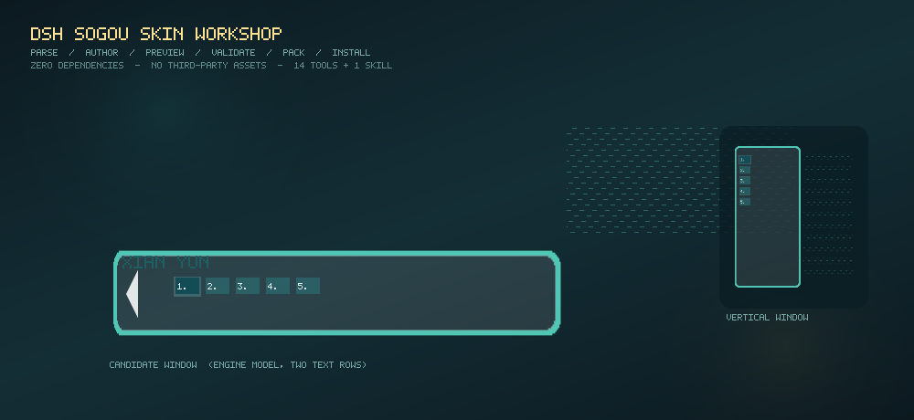
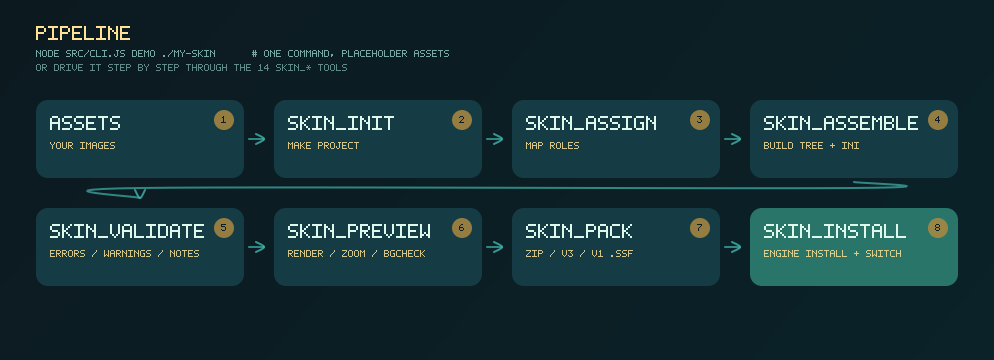
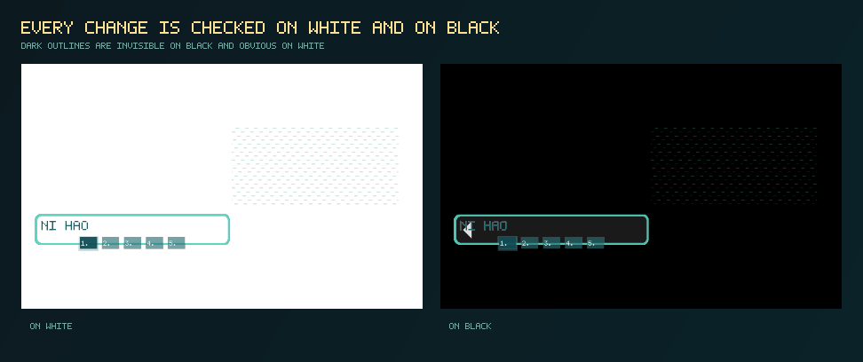
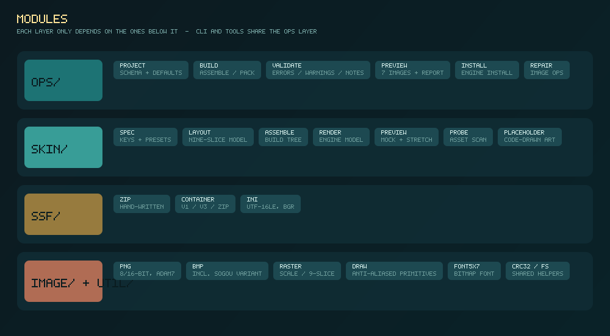

# dsh-sogou-skin

**搜狗输入法皮肤工坊** —— 一个能**解析、制作、预览、校验、打包、安装** `.ssf` 皮肤的工具箱。

既是 [DeepSeek Harness](https://github.com/deepseek-ai) 插件（**14 个工具 + 1 个技能**），
也是一个**独立命令行程序**（14 条命令）。**零第三方运行时依赖** —— PNG / BMP 编解码、
ZIP 与三代 `.ssf` 容器、九宫格窗口模型、抗锯齿绘图原语，全部是自己写的纯 JavaScript，
只用到 Node 内置的 `zlib` / `crypto`。



> **本仓库不含任何皮肤素材。** 上面这些效果图也全部由代码画出来，见
> [`docs/make-images.mjs`](docs/make-images.mjs)。详见 [ASSET_NOTICE.md](ASSET_NOTICE.md)。

---

## 为什么需要它

做一个搜狗皮肤本来是这样一件事：凑齐几十张图片 → 搞懂 `Skin.ini` 里一百多个键 →
打包 → 装上 → 重启输入法 → 看效果 → 不对 → 改 → 再来一遍。
最麻烦的是**中间那步完全靠猜**：底图该切几宫格？文字该放在哪一行？
为什么立绘被拉扁了？为什么候选词第二行掉到桌面上？

这个项目把"猜"变成了"算"：**引擎的行为是从真实皮肤与真机截图里标定出来的**，
不是推测。工具会在你打包之前就告诉你哪里会出问题，并且**校验器只在真错误上报警**
（正常皮肤零 error、零误报）。

---

## v0.2.0 做了什么

- **结构重写**：新增 `src/ops/` 应用层，CLI 与 14 个工具共用同一份实现；
  以前 `validate` 在工具和 CLI 里是两套逻辑，现在只有一套。
- **出图更可信**：`render.png` 按真机量级出多宽度/多候选/状态栏三态视图；
  新增 `zoom.png`（头/中/尾逐段放大、状态栏按钮 1x 与 1.75x）、
  `report.txt`（中文量化报告）；`bgcheck.png`/`stretch.png` 按真实变化方向重做。
- **校验器去误报**：错误 / 警告 / 提示三级；对复刻-雷电将军、闲云 v1 工程、
  两套真实商店 `.ssf`、官方 `Skin.dat` 全部 **0 error、0 warning**。
- **真正支持三代容器**：v0.1.0 文档写了 v1 但代码没实现；现在 `v1` 可读可写，
  并且用本机 `skin_v3.dat` 验证过"解包→重打包逐字节相同"。
- **安装走引擎真实路径**：`skin_install` 默认调用 `SGTool.exe` 的安装对话框，
  由引擎自己完成复制 `.ssf`、重建 `skin_v3.dat`、切换当前皮肤；复制只是兜底。
- **按需生成段落**：不再无条件写 `bar_mask` / 分体底图 / 假的 `Scheme_H2`/`Scheme_V2`；
  `layered`、`pic_mask` 默认不写；`<按钮>_display=1` 默认**写**（真机验证：不写时部分版本按钮整体不显示）。
- **工程体验**：`skin.project.json` schema 自校验、字符串简写、`anchors` 生效、
  `assets.scale` 支持 2x 素材、按钮坐标缺省自动排布。

---

## 效果图

### 一条流水线



### 每一步都在白底和黑底各看一次



勾边色如果用了近黑，**在黑底上完全隐形、在白底上就是一道黑边**。
这个项目吃过这个亏（见 [LESSONS.md 第 12 条](docs/LESSONS.md)），
所以预览器**每次自动产出白底/黑底对照**，不靠人记得。

---

## 功能

### 14 个工具

| 工具 | 作用 |
|---|---|
| `skin_requirements` | 一套皮肤最少需要哪些素材、工程默认值、引擎窗口标定数据 |
| `skin_init` | 建工程（`skin.project.json` + `assets/` + `preview/`）|
| `skin_scan_assets` | 扫描素材目录，报告尺寸、透明度、主色、槽位建议 |
| `skin_assign` | 把素材分配到槽位、改配色、启停按钮、配置浮层 |
| `skin_assemble` | 装配成皮肤文件树 + `Skin.ini` |
| `skin_preview` | **按引擎模型真渲染**：render / zoom / bgcheck / stretch / assets / preview + report |
| `skin_repair` | 内置小图片编辑器（抠图、裁剪、缩放、色相、描边…）|
| `skin_pack` | 打包成 `.ssf`（zip / v3 / v1；也支持逐字重打包已解包目录）|
| `skin_inspect` | 查看 `.ssf` 的完整结构（三代容器）|
| `skin_unpack` | 解开 `.ssf`，另存 UTF-8 的 `Skin.ini` |
| `skin_validate` | 校验（支持工程目录 / 解包目录 / `.ssf`），只有真错误才失败 |
| `skin_overlay_presets` | 浮层按钮的 15 组官方对齐预设 |
| `skin_install` | 装到本机搜狗（引擎安装路径 + 复制兜底）|
| `skin_list_installed` | 列出本机已装皮肤 |

外加技能 **`sogou-skin-authoring`**：把"像设计师一样做皮肤"的完整流程
（先定配色 → 逐图层 → 每步识图 → 不满意就返工）写成可复用步骤。

### 能力清单

- **三代 `.ssf` 容器**全部可读写：明文 ZIP / `"Skin"+u32(3)` AES-256 + zlib / `"Skin"+u32(1)` 明文内层
- **PNG**：8/16 位，灰度 / 调色板 / RGB / RGBA，Adam7 隔行
- **BMP**：含搜狗特有的 20×20 按钮变体（1254 与 1256 字节两种尾部）
- **绘图原语**：多段线性渐变、径向渐变、抗锯齿曲线、外/内发光、高斯模糊、颗粒、**沿轮廓勾边**
- **位图基元**：缩放、九宫格、抠图、调色、主色提取、内容裁剪
- **程序化占位素材**：不需要任何素材就能产出一套**可安装**的皮肤
- **跨版本安装探测**：标准版 / 医生版 / 各安装路径

---

## 模块



分四层，**上层只依赖下层**：

```
ops/     应用层 —— 工程/装配/打包/校验/预览/安装/修图（CLI 与工具共用）
skin/    业务层 —— 键词表、九宫格模型、装配器、引擎模型渲染、预览出图
ssf/     容器层 —— 手写 ZIP、三代容器识别与加解密、Skin.ini 解析
image/   图像层 —— PNG/BMP 编解码、位图基元、绘图原语、点阵字体
util/    公共层 —— CRC32、路径/文件、数字与文本工具
```

| 文件 | 说明 |
|---|---|
| `src/ops/project.js` | 工程 schema 校验、默认值、加载/保存、素材分配 |
| `src/ops/build.js` | 装配 / 打包 / 解析 / 解包（唯一实现）|
| `src/ops/validate.js` | **唯一校验器**，输出 errors / warnings / notes |
| `src/ops/preview.js` | 预览出图调度 + 中文量化报告 |
| `src/ops/install.js` | 引擎安装（SGTool 对话框）+ 复制兜底 |
| `src/skin/spec.js` | 304 个已知键、7 个段落、13 个按钮槽位、15 组官方浮层预设 |
| `src/skin/layout.js` | **九宫格模型唯一真源**：夹取 / 退化 / 平铺 / 接缝 / 候选条背景 |
| `src/skin/assemble.js` | 从工程配置装配出完整皮肤 |
| `src/skin/render.js` | 引擎模型渲染器（多宽度、多候选、状态栏三态、白底对照、放大图）|
| `src/skin/preview.js` | 总览看板 / 素材表 / 拉伸体检图 |
| `src/ssf/container.js` | 三代容器识别 + v3 AES-256-CBC + v1 明文内层 |
| `src/ssf/zip.js` | 手写 ZIP，含搜狗私有 `SD` 扩展字段 |
| `src/ssf/ini.js` | UTF-16LE + BOM 解析，**颜色是 `0xBBGGRR` 不是 RGB** |
| `src/image/draw.js` | 抗锯齿绘图原语（线/曲线/圆角/渐变/发光/模糊/勾边）|
| `src/image/raster.js` | 位图操作（缩放/九宫格/抠图/调色/主色/裁剪）|

---

## 它是怎么工作的

### 引擎模型

这几条结论**全部来自真实皮肤与真机截图**，不是推测：

**① 窗口尺寸 —— 纵向永不缩放**

真机实测（DPI 168，缩放 1.75×）：底图 650×258 → 候选窗 460×259 逻辑像素。
**宽度按内容算（实测 460 / 646），高度 = 底图原始高度。**

**② 九宫格退化 —— "整张图被压扁"的唯一根因**

引擎要把底图按九宫格铺进 W×H 的窗口。只要：

```
left + right > W      或      top + bottom > H
```

九宫格就不成立，引擎**只能把整张底图硬缩放到 W×H** —— 立绘被压扁、文字跑位、
上下两排错乱，全是这一个原因。注意 `left+right === W` 是**合法**的：
四角正好拼满、中段宽度为 0（复刻-雷电将军原生 400 宽窗口就是这样）。

关键推论：**只在真正会变化的那根轴上设内缩**。

| 段落 | 怎么变 | 该设防的轴 | 另一轴 |
|---|---|---|---|
| 横排候选窗 | 打字变长 → 只变宽 | `layout_horizontal` | `layout_vertical = 0,0,1` |
| 竖排候选窗 | 候选变多 → 只变高 | `layout_vertical` | `layout_horizontal = 0,0,1` |

**③ 候选窗里是上下两排文字**

```
  ┌──────────────────────────────────────┬──────────┐
  │ 搜狗PINYIN            ← 拼音行        │          │
  │ 1.拼音 2.品 3.频 4.拼 5.贫 ◀ ▶  ← 候选行│  立绘    │
  └──────────────────────────────────────┴──────────┘
```

```
拼音行 y = pinyin_marge[0]                                  ← 【绝对 y】
候选行 y = pinyin_marge[0] + font_size + zhongwen_marge[0]  ← 后者是【间距】
```

> 这两个字段的语义**不一样**，混起来会让候选行偏出一百多像素。
> 这个 bug 在本项目里真实存在过，见 [LESSONS.md](docs/LESSONS.md)。

**④ 候选条必须贴到图片底边**

候选词会依次往下排。如果底图里条子下方是透明的，第二行以后的候选就没有背景。
修法：条子下沿做到图片底边，并把 `layout_vertical` 改成 `<条子上沿 y>,0`。

### 一条命令的流程

```
  你的图片  →  skin_init  →  skin_assign  →  skin_assemble
                                               ↓
                            skin_install  ←  skin_pack  ←  skin_preview
```

---

## 用法

### 最快：不需要任何素材

```
node src/cli.js demo ./my-skin
```

一条命令建工程 → 生成占位素材 → 装配 → 预览 → 打包，得到一个**能装的 `.ssf`**。

### 用自己的素材

```
node src/cli.js requirements              # 先看需要哪些素材
node src/cli.js init     ./my-skin        # 建工程
#   把图片放进 my-skin/assets/，再编辑 skin.project.json 分配角色
node src/cli.js scan     ./my-skin        # 扫描素材，报告客观特征
node src/cli.js assemble ./my-skin        # 装配
node src/cli.js validate ./my-skin        # 校验（出错返回非零退出码）
node src/cli.js preview  ./my-skin        # 出预览图，先看 render.png
node src/cli.js pack     ./my-skin --out my-skin.ssf
node src/cli.js install  my-skin.ssf      # 装到本机搜狗（引擎安装 + 自动切换）
```

全部命令：

```
node src/cli.js requirements                  列出做皮肤需要哪些素材
node src/cli.js init <dir> [--name X]         新建皮肤工程
node src/cli.js scan <dir>                    扫描素材目录
node src/cli.js assemble <projectDir>         装配出皮肤目录
node src/cli.js validate <target>             校验（工程目录/解包目录/.ssf；错误返回非零）
node src/cli.js preview <projectDir>          生成预览图套件
node src/cli.js pack <dir> [--format zip|v3|v1] [--out x.ssf] [--template t.ssf] [--set k=v]
node src/cli.js inspect <file.ssf>            解析皮肤包
node src/cli.js unpack <file.ssf> [dir]       解包皮肤
node src/cli.js repair <src> --op '{...}'     内置修图
node src/cli.js install <file.ssf> [--mode auto|engine|copy] [--dry-run]
node src/cli.js list [--target dir]           列出本机已装皮肤
node src/cli.js overlay-presets               官方浮层对齐预设
node src/cli.js demo <dir>                    一条龙演示（占位素材）
```

所有命令都支持 `--json` 输出机器可读结果；`--help` 查看帮助。

### 作为 DSH 插件

在 DeepSeek Harness 桌面版的「设置 → 插件」里安装本仓库目录即可（profile 会以 `link:` 方式引用本地仓库，改动立即生效）。装好后可以直接用自然语言驱动 14 个工具，技能 `sogou-skin-authoring` 会引导整个创作流程。

手动安装：在 DSH profile 的 `package.json` 里加一条 link 依赖，并登记到 `dsh.profile.bundles`：

```json
{
  "dsh": {
    "profile": {
      "bundles": ["@deepseek-ai/dsh-base", "@deepseek-ai/dsh-web-app", "@dsh-external/dsh-sogou-skin"]
    }
  },
  "dependencies": {
    "@dsh-external/dsh-sogou-skin": "link:F:/path/to/dsh-sogou-skin"
  }
}
```

（本仓库不带 `dsh` 命令行入口，安装通过 Harness 的插件管理界面或上面的 profile 配置完成。）

### 从别人的皮肤克隆/改造

```
node src/cli.js unpack 别人的.ssf ./work
#   改 ./work/Skin.ini 或替换图片
node src/cli.js pack ./work --set skin_name=我的皮肤 --set skin_author=我 --out 我的.ssf
```

`unpack → pack` 是**逐字**的：条目名、顺序、内容都会原样还原（v1 容器连字节都相同），
这是"复刻真实皮肤"最稳的路径。**改别人的皮肤再分发前请确认素材版权。**

### 支持哪些搜狗版本

安装路径探测覆盖：

| 版本 | 用户皮肤目录 |
|---|---|
| 标准版搜狗 | `%APPDATA%\SogouInput\AllSkin`、`%LOCALAPPDATA%\SogouInput\AllSkin` |
| **搜狗医生版** | **`%USERPROFILE%\AppData\LocalLow\SogouYS\AllSkin`** ← 注意是 **LocalLow** |
| 部分版本 | 安装目录下的 `<版本号>\AllSkin`（`Program Files (x86)\SogouYSInput` 等）|

> **LocalLow 是 Local 的兄弟目录，不是子目录。** 这一点卡了很久 ——
> 医生版既不在 `Local` 也不在 `APPDATA`，常规经验完全找不到。
> 找不到时工具会打印各版本的常见位置，以及怎么自行定位。

**安装/切换皮肤**：`skin_install` 默认调用搜狗的 `SGTool.exe`
（`-line 0 -border --appid=skinreg -install <x.ssf>`）弹出「安装皮肤」对话框并自动点「确定」，
由**引擎自己**完成复制 `.ssf`、重建 `skin_v3.dat`、更新 `env.ini` 的 ActiveSkinName、
更新最近使用列表 —— **不需要重启输入法**。`--mode copy` 只复制文件（需要用户自己切换/重启）。

> 注意：`skin_v3.dat` 不是渲染缓存，而是引擎持久化的皮肤数据快照；
> 引擎进程常驻内存持有皮肤，所以**手改文件、改 `env.ini`、删 `skin_v3.dat` 都不会让前台应用重载**。
> 详见 [LESSONS.md 第 1 条（v0.2.0 修正）](docs/LESSONS.md)。

---

## 预览图怎么看

`skin_preview` / `preview` 在工程 `preview/` 下产出：

| 文件 | 看什么 |
|---|---|
| `render.png` | **首选**。引擎模型真渲染：横排 460/646 宽、长拼音长候选、竖排 9/14 个候选、状态栏三态 |
| `zoom.png` | 像素级细节：头/中/尾三段放大、候选条下沿、状态栏按钮 1x 与 1.75x（DPI168） |
| `stretch.png` | 沿真实轴拉伸：横排变宽 / 竖排变高，四角是否变形、中段有没有花纹 |
| `bgcheck.png` | 白底/黑底对照（按真机宽度拉伸后），看勾边是不是近黑 |
| `assets.png` | 素材总览：尺寸、格式、透明通道 |
| `preview.png` | 一页总览看板（**不能用来判断变形**）|
| `report.txt` | 中文量化报告：九宫格 L/R/T/B、两排文字 y、中段接缝色差、候选条背景覆盖率、全部 errors/warnings/notes |

---

## 测试

全部测试 **不需要任何外部素材**，在干净 checkout 里可直接运行：

```
node test/run.mjs          # 单元 / 契约测试
node test/run.mjs --all    # 再加集成测试（CLI 全命令、端到端、文档一致性）
```

测试自己造数据（程序化占位素材 + 手工构造的 PNG/BMP/ZIP），所有断言真跑：

| 测试 | 守住什么 |
|---|---|
| `image.test.mjs` | PNG/BMP 往返、光栅操作、九宫格边界语义、点阵字体 |
| `ssf.test.mjs` | 三代容器往返、ZIP 结构不变量、v1/v3 内层、Skin.ini 编解码 |
| `layout.test.mjs` | 九宫格模型（退化判据、夹取、平铺）、接缝与候选条背景检测 |
| `project.test.mjs` | 工程 schema 校验、默认值、旧 schema 迁移、素材分配 |
| `assemble.test.mjs` | 装配产物结构、"按需生成段落"、anchors/2x/确定性、不修改传入对象 |
| `render.test.mjs` | 两排文字公式、横竖排候选、退化渲染、状态栏、白底/放大图 |
| `validate.test.mjs` | 健康数据 0 error 0 warning；真问题必须报；提示层不判失败 |
| `preview.test.mjs` | 7 个产物齐全可解码、报告数字真实、"改素材必改图" |
| `plugin.test.mjs` | 14 工具 + 技能注册、schema、错误处理、逐工具实跑 |
| `cli.test.mjs` | 真的起子进程跑每一条 CLI 命令；README 命令清单与代码一致 |
| `e2e.test.mjs` | 装配→打包（zip/v3/v1）→解包→逐字重打包；v1 字节相同；克隆只改身份字段 |
| `docs.test.mjs` | 版本/工具清单三处一致、README 引用存在、无本机路径/素材/临时文件 |

测试运行器还做两道防假通过校验：每个文件必须打印非零断言数；
输出里出现 `FAIL` 或"跳过"一律判失败（本套件不允许静默跳过）。

### 真实样本验证（可选）

仓库里没有皮肤素材，但你可以用本机已有的真实文件验证容器实现：

```
$env:SOGOU_SKIN_DAT='C:\Users\<你>\AppData\LocalLow\SogouYS\skin_v3.dat'
$env:SOGOU_SKIN_SAMPLES='D:\你的皮肤样本目录'
node scripts/verify-real-samples.mjs
```

它会做：读取 → 同格式重打包 → 解包 → 逐字重打包，并逐字节对比。
v1（`skin_v3.dat`）重打包后应当**与原文件完全相同**。

---

## 文档

| 文档 | 内容 |
|---|---|
| **[docs/LESSONS.md](docs/LESSONS.md)** | **推荐先读。** 20+ 条真实踩过的坑，按"早知道能省多少事"排序 |
| [docs/SSF-FORMAT.md](docs/SSF-FORMAT.md) | `.ssf` 三代容器格式与 `Skin.ini` 结构解析 |
| [docs/PROJECT-SCHEMA.md](docs/PROJECT-SCHEMA.md) | `skin.project.json` 字段、默认值与示例 |
| [docs/VERIFY.md](docs/VERIFY.md) | v0.2.0 的真实命令验证记录（含两个真实工程的产物）|
| [CHANGELOG.md](CHANGELOG.md) | 版本能力与修复清单 |
| [ASSET_NOTICE.md](ASSET_NOTICE.md) | 素材声明 |
| [test/README.md](test/README.md) | 每个测试测什么、为什么不允许"跳过" |
| [examples/README.md](examples/README.md) | 示例说明 |

`docs/LESSONS.md` 里有几条比代码更值钱的东西，比如：

- **「改了文件」≠「引擎用了新文件」** —— 搜狗把皮肤数据持久化在 `skin_v3.dat`，
  但真正让前台应用重载的是引擎的安装流程，不是删缓存
- **看图说不清时，去量一个数** —— 我"觉得按钮圆角被切了"，量了 alpha 才发现真正的问题是"上半块全透明"
- **会在合法输入上报错的断言，比没有断言更糟** —— 它会驱使你去改坏本来正确的东西

---

## 目录结构

```
dsh-sogou-skin/
├── src/
│   ├── index.js            插件入口（注册工具与技能）
│   ├── tools.js            14 个 skin_* 工具（薄层）
│   ├── cli.js              独立命令行入口（薄层）
│   ├── commands.js         CLI 命令表（单一真源）
│   ├── ops/                应用层（工程/装配/校验/预览/安装/修图）
│   ├── skin/               业务层（规格/九宫格/装配/渲染/预览）
│   ├── ssf/                容器层（三代容器 + Skin.ini）
│   ├── image/              零依赖图像层
│   └── util/               公共工具
├── skills/sogou-skin-authoring/SKILL.md
├── scripts/verify-real-samples.mjs
├── examples/
├── test/                  12 个测试文件 + 运行器
└── docs/
    ├── LESSONS.md
    ├── SSF-FORMAT.md
    ├── PROJECT-SCHEMA.md
    ├── VERIFY.md
    ├── make-images.mjs
    └── images/
```

---

## 许可

代码：**MIT**（见 [LICENSE](LICENSE)）。

**素材：本仓库不包含任何素材。** 插件里的"占位素材"都是运行时用代码画出来的几何图形，
效果图也全部由 [`docs/make-images.mjs`](docs/make-images.mjs) 生成。
详见 [ASSET_NOTICE.md](ASSET_NOTICE.md)。
